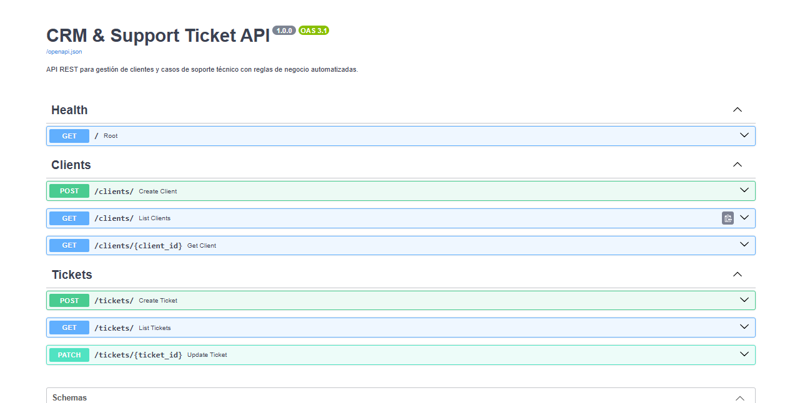

# CRM & Support Ticket REST API

API RESTful desarrollada en **Python** con **FastAPI** y **PostgreSQL** para la gestión de clientes y casos de soporte técnico, implementando arquitectura modular, validación estricta de datos y reglas de negocio automatizadas orientadas a flujos CRM.

## Características y Reglas de Negocio
* **Gestión Relacional (1:N):** Asociación de múltiples tickets de soporte (`Tickets`) a cada cuenta de cliente (`Clients`), replicando el modelo estándar *Account → Case* de plataformas CRM empresariales.
* **Automatización de Ciclo de Vida:** Cuando un cliente en estado `Prospecto` registra su primer ticket de soporte, su estado se actualiza automáticamente a `Activo`.
* **Validación de Cierre de Casos:** El sistema impide cerrar un ticket (`Cerrado`) si no se proporciona una descripción válida de la resolución aplicada, garantizando trazabilidad técnica.
* **Filtros Dinámicos:** Consulta de tickets filtrables por estado (`Abierto`, `En Progreso`, `Cerrado`) y nivel de prioridad (`Baja`, `Media`, `Alta`).

## Stack Tecnológico
* **Lenguaje:** Python 3.12+
* **Framework Web:** FastAPI + Uvicorn
* **ORM y Base de Datos:** SQLAlchemy + PostgreSQL (`psycopg2`)
* **Validación de Datos:** Pydantic
* **Control de Versiones:** Git & GitHub

## Arquitectura del Proyecto

crm-support-api/
├── app/
│   ├── main.py        # Definición de endpoints REST y configuración de FastAPI
│   ├── database.py    # Gestión de conexión y sesiones con PostgreSQL
│   ├── models.py      # Modelos relacionales ORM (Client y Ticket)
│   ├── schemas.py     # Esquemas de validación de entrada/salida (Pydantic)
│   └── crud.py        # Lógica de negocio y operaciones en base de datos
├── requirements.txt   # Dependencias del entorno
└── README.md          # Documentación del proyecto
## Vista Previa

